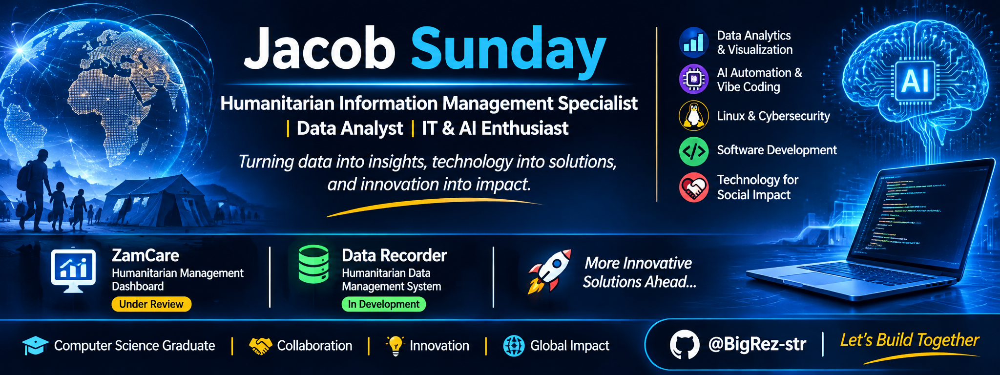

# 👋 Hi, I'm Jacob Sunday

### Humanitarian Information Management Specialist | Data Analyst | IT & AI Enthusiast

Welcome to my GitHub profile!

I am a Computer Science graduate passionate about using technology, data and innovation to solve real-world problems.

My interests span humanitarian information management, data analytics, IT solutions, software development, artificial intelligence and workflow automation.

I enjoy exploring how technology can improve organisational efficiency, strengthen humanitarian operations and support evidence-based decision-making.

---

## 👨‍💻 About Me

- 🎓 BSc in Computer Science – Adamawa State University, Mubi.
- 🌍 Humanitarian Information Management and Emergency Response.
- 📊 Data Analytics, Data Management and MEAL.
- 💻 IT Support, Systems Administration and Technical Solutions.
- 🤖 Artificial Intelligence and AI Workflow Automation.
- 🚀 AI-Assisted Development and Vibe Coding.
- 🐍 Python Programming and Application Development.
- 🔐 Linux Administration and Cybersecurity.
- 🌐 Interested in building practical digital solutions.

---

## 🛠️ Technical Skills & Interests

### 📊 Data Analytics & Information Management
- Microsoft Excel
- Python and Pandas
- NumPy
- Data Cleaning and Validation
- Data Analysis and Visualization
- Monitoring, Evaluation and Reporting

### 💻 IT & Systems
- Linux Administration (Linux Mint)
- Operating System Installation and Configuration
- IT Support and Troubleshooting
- Networking Fundamentals
- Git and GitHub
- Technical Documentation

### 🤖 Artificial Intelligence & Automation
- AI Tools and Applications
- AI Workflow Automation
- Prompt Engineering
- AI-Assisted Software Development
- Vibe Coding
- Exploring AI Agents and Intelligent Applications

### 🧑‍💻 Programming & Development
- Python
- Django
- HTML and CSS
- Streamlit
- SQLite
- Web Application Development
- Software Prototyping

---

## 🚀 Featured Projects

### 1. ZamCare – Humanitarian Management Dashboard

A digital humanitarian management dashboard developed for the Ministry of Humanitarian Affairs and Relief Matters, Zamfara State.

The project focuses on supporting humanitarian information management through a centralised digital platform.

**Technologies:** Python, Django, HTML and CSV data integration.

**Status:** Under Review.

🔗 [View ZamCare Repository](https://github.com/BigRez-str/ZamCare)

### 2. Data Recorder – Humanitarian Data Management System

A humanitarian data collection and management project designed to support beneficiary registration, needs assessments, data validation, monitoring, evaluation, accountability and reporting.

**Planned Technologies:** Python, Pandas, NumPy, Streamlit and SQLite.

**Status:** Currently in Development.

🔗 [View Data Recorder Repository](https://github.com/BigRez-str/data-recorder)

### 3. Future IT & AI Projects

Exploring practical solutions involving:
- AI-powered workflow automation.
- Intelligent data analysis tools.
- AI-assisted application development.
- Digital productivity solutions.
- Technology-driven organisational solutions.

---

## 🎯 Current Learning Goals

- Building practical Python applications.
- Developing AI-powered applications.
- Exploring AI automation and workflow integration.
- Improving software development skills through vibe coding.
- Learning Linux administration and cybersecurity.
- Developing database management skills.
- Building interactive dashboards and data applications.
- Exploring intelligent digital solutions.

---

## 🤝 Collaboration & Opportunities

I am interested in collaborating on projects involving:

- Humanitarian Technology and Digital Transformation.
- Data Analytics and Information Management.
- IT Support and Technical Solutions.
- Artificial Intelligence and Automation.
- Software Development and Open-Source Projects.
- Technology for Social Impact.

---

## 📫 Let's Connect

- **GitHub:** [@BigRez-str](https://github.com/BigRez-str)

---

### 💡 My Philosophy

*"Turning data into insights, technology into solutions, and innovation into impact."*
